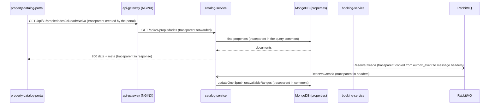

# CP1 · Journey: search available properties

A guest types a city, dates and number of guests in the Catalog portal. The answer
comes from `catalog-service` (Python, FastAPI, MongoDB). Catalog never calls Booking:
it hides the taken dates using `unavailableRanges`, which it keeps up to date by
consuming the events of `booking-service` (ADR-013, E-05 in
`07-api/contracts/catalog-endpoint-fiches.md`). So this journey has a synchronous part
(the search) and an asynchronous part (the availability update), and both must be
traceable.

## Hops

| Step | Caller | Callee | Protocol | Operation | Sync/Async | Data |
|---|---|---|---|---|---|---|
| 1 | `property-catalog-portal` (:4201) | `api-gateway` (NGINX :8080) | REST | `GET /api/v1/propiedades?ciudad=&fechaInicio=&fechaFin=&huespedes=` (E-05) | sync | none |
| 2 | `api-gateway` | `catalog-service` (:3002) | REST | `GET /api/v1/propiedades` (public, no credential) | sync | none |
| 3 ⚑ | `catalog-service` | MongoDB `catalog` | Mongo wire | `find` on `properties` with index `idx_properties_city_capacity`, excluding overlapping `unavailableRanges` | sync | `properties` |
| 4 | `property-catalog-portal` | `api-gateway` → `catalog-service` | REST | `GET /api/v1/propiedades/{id}` (E-06) | sync | `properties` |
| 5 | `booking-service` (outbox relay) | RabbitMQ | AMQP | publish `ReservaCreada` / `ReservaCancelada` / `ReservaExpirada` | async | `booking.outbox_event` |
| 6 | `catalog-service` (consumer) | RabbitMQ | AMQP | consume the event, add or remove the range | async | `properties.unavailableRanges`, `processed_events` |

⚑ Hop 3 is the one used in the CP9 drill: its downstream dependency is MongoDB.

## Sequence

How the context travels:

- **HTTP:** W3C header `traceparent`. The portal starts the trace when the guest presses
  "Buscar"; NGINX passes it through; `catalog-service` answers it back.
- **MongoDB:** the driver has no headers, so the `traceparent` goes in the `comment` of
  the query. It shows up in the Mongo profiler and slow-query log, so a slow `find` can
  be tied to a trace.
- **RabbitMQ:** `booking-service` saves `traceparent` in the outbox row and the relay puts
  it in the AMQP message headers. The consumer of Catalog reads it there.

## Span tree

Trace A — the search (one `trace_id`):

- `GET /api/v1/propiedades` — api-gateway (root)
  - `GET /api/v1/propiedades` — catalog-service
    - `mongo find properties` — catalog-service (db span)
  - `GET /api/v1/propiedades/{id}` — catalog-service (when the guest opens a card)
    - `mongo findOne properties` — catalog-service

Trace B — the availability update. It starts in Booking, and the async boundary keeps
the same `trace_id`:

- `POST /api/v1/reservas` — booking-service (root, from the Saga)
  - `insert outbox_event` — booking-service
- `relay publish ReservaCreada` — booking-service (**crosses the async boundary**)
  - `consume ReservaCreada` — catalog-service
    - `check processed_events` — catalog-service
    - `mongo updateOne unavailableRanges` — catalog-service
