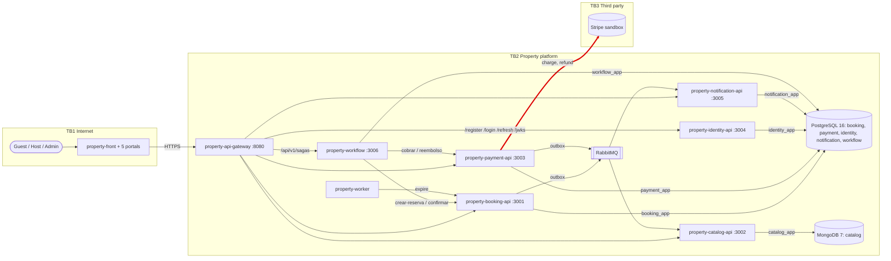

# CP1 — Attack surface of Property

Sources: property-docs 05-architecture/overview.md, 05-architecture/deployment.md and the
OpenAPI contracts in 07-api/contracts/. My boundary, in red: **payment-api -> Stripe (external API)**.

## Assets of my boundary

| Asset | Where it lives | Classification |
|---|---|---|
| Stripe secret key | env file of payment-api (not versioned) | restricted |
| tokenPago (card token) | request from workflow; sent to Stripe; never stored or logged | restricted |
| montoCents of the charge | computed by booking-api, sent to Stripe | confidential |
| gateway_transaction_id | payment.payment | confidential |
| Idempotency key of the charge (<sagaId>:cobrar) | payment.idempotency_key and the Stripe request | internal |

## Entry points of my boundary

| Entry point | Who calls it | Authentication today |
|---|---|---|
| HTTPS call to the Stripe API (charge, refund) | payment-api | secret key in the Authorization header |
| Step cobrar from property-workflow | workflow -> payment-api | JWT with scope service |
| GET /api/v1/pagos/{id} (E-07) | front through the gateway | JWT; own Pago only, ADMIN or service read any |
